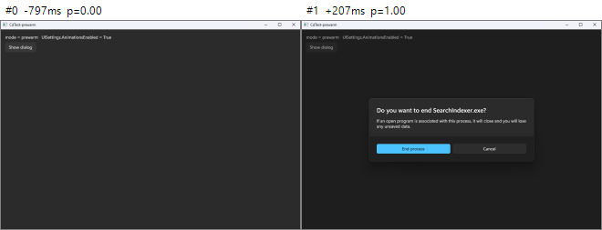
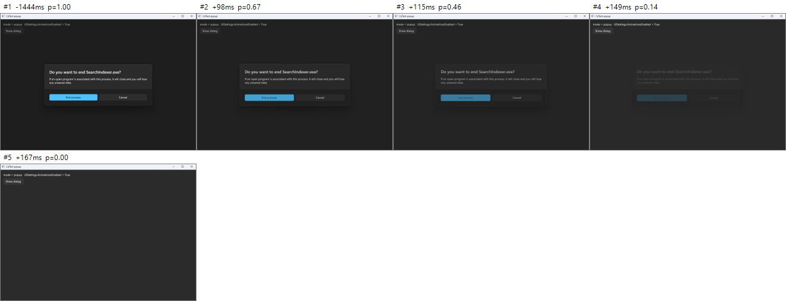
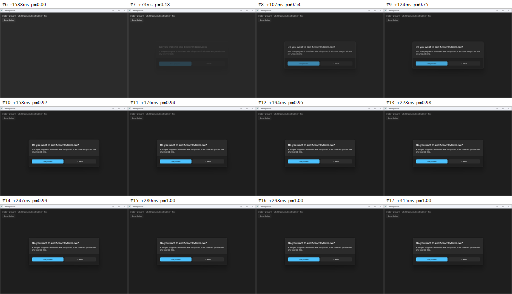
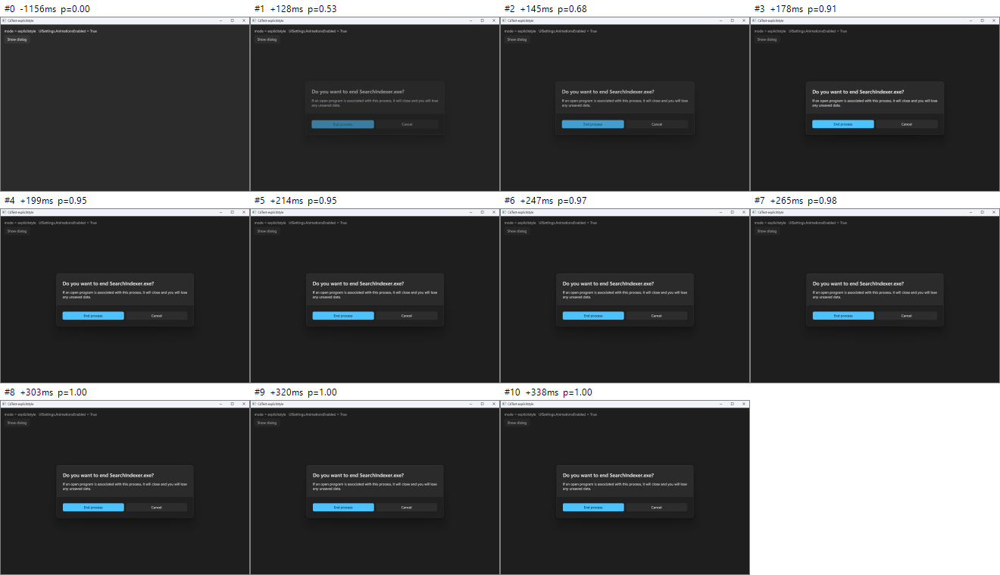
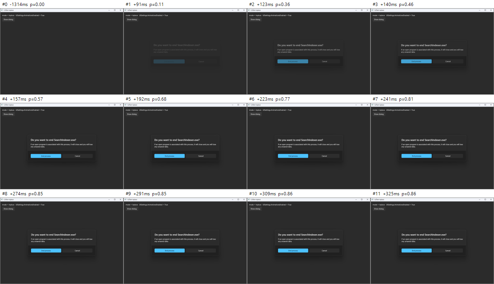
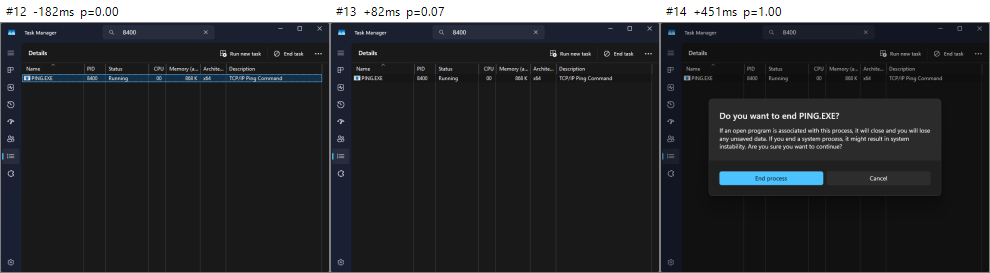
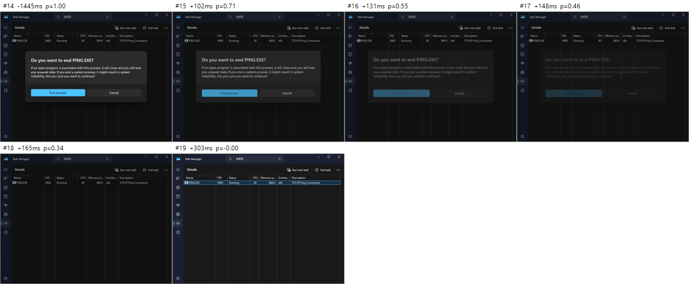

# ContentDialog is missing the entrance transition — Source Analysis and Empirical Report

Tracks [microsoft/microsoft-ui-xaml#8476](https://github.com/microsoft/microsoft-ui-xaml/issues/8476) · Source under analysis: local `microsoft-ui-xaml` repo (branch `winui3/main`, commit `03388e3d3`) · Tested 2026-09-27

## Contents

- [0. TL;DR](#0-tldr)
- [1. Background: which XAML stack Task Manager actually runs](#1-background-which-xaml-stack-task-manager-actually-runs)
- [2. How ContentDialog open/close animations are implemented](#2-how-contentdialog-openclose-animations-are-implemented)
- [3. Methodology and tooling](#3-methodology-and-tooling)
- [4. Results](#4-results)
- [5. ETW trace: the enter Storyboard is never even created](#5-etw-trace-the-enter-storyboard-is-never-even-created)
- [6. Hypotheses ruled out](#6-hypotheses-ruled-out)
- [7. Root cause (step-by-step timeline + source)](#7-root-cause-step-by-step-timeline--source)
- [8. Why close works and second-show works](#8-why-close-works-and-second-show-works)
- [9. A second, related bug: ContentDialog declared in the XAML tree](#9-a-second-related-bug-contentdialog-declared-in-the-xaml-tree)
- [10. Applying this to Task Manager](#10-applying-this-to-task-manager)
- [11. Recommended fix (framework side)](#11-recommended-fix-framework-side)
- [12. App-side workaround (verified)](#12-app-side-workaround-verified)
- [13. Appendix: data, files, repro steps](#13-appendix-data-files-repro-steps)

## 0. TL;DR

- **Repro confirmed**: a code-created WinUI 3 `ContentDialog` (Windows App SDK 2.3.1 runtime) shows **zero** intermediate frames on its **first** `ShowAsync()` — it pops in at its final state. Dismissing it produces 2–4 intermediate frames (fade-out + scale up to 1.05).
- **Not a timing/perf artifact**: showing the *same instance* a second time animates correctly (6–7 intermediate frames, ~150–250 ms) — even if the UI thread is deliberately stalled for 200 ms on the opening frame.
- **ETW evidence**: on first show, XAML emits zero `BeginStoryboard` (the enter Layout Transition is never realized) plus 8–9 extra `CancelTransitions`. Second show and every dismiss produce normal Storyboards.
- **Root cause**: when the dialog is first templated inside the popup, `OnApplyTemplate` finds the `SmokeLayerBackground` template part for the first time and sets `m_prepareSmokeLayerAndPopup = true`; then `BackgroundElement.SizeChanged → OnDialogSizeChanged → HostDialogWithinPopup(true)` **unconditionally** re-assigns `m_tpPopup->put_Child(this)`. `CPopup::SetChild` calls `RemoveChild()` first, so the dialog leaves and re-enters the visual tree within the same layout tick:
  - `CUIElement::LeaveImpl` calls `UnregisterElementForTransitions` + `CancelTransitions`, throwing away the just-registered, not-yet-realized **Load** transition;
  - after re-enter, `m_enteredTreeCounter == m_leftTreeCounter == layoutCounter`, so the next Arrange is classified as a **Reparent** trigger. `ContentDialogOpenCloseThemeTransition` only participates in `Load/Unload`, so the enter animation silently disappears.
- **Dialogs from a standalone XAML file are unaffected**: a dialog defined as `<ContentDialog x:Class=…>` and created via `new MyDialog()` animates on first show, with or without a Style on the root element (see 8.1). Only a pure code-created `new ContentDialog()` hits this bug.
- **App-side workaround (verified)**: explicitly assign `dialog.Style = (Style)Application.Current.Resources["DefaultContentDialogStyle"];` before `ShowAsync()` — first show then animates (5 intermediate frames, completing at +128 → +247 ms).
- **Task Manager**: it is XAML Islands (`DesktopWindowXamlSource`) + inbox `Windows.UI.Xaml.dll` + WinUI 2 (`Microsoft.UI.Xaml.CBS`), and both the system DLL and the WinUI 2 style resources contain the same `SmokeLayerBackground` machinery. Frame-by-frame capture of Task Manager's "End task" confirmation: 3 consecutive opens all pop in with 0 enter frames, while dismiss animates with 3–5 frames every time — byte-for-byte the same symptom as WinUI 3 (see §10).

## 1. Background: which XAML stack Task Manager actually runs

First, pin down which code Task Manager's dialog actually executes. String analysis of `C:\Windows\System32\Taskmgr.exe` (10.0.26100.1591):

| String | Present | Meaning |
|---|---|---|
| `DesktopWindowXamlSource` | yes | hosts XAML content via XAML Islands |
| `ContentDialog` | yes | uses ContentDialog |
| `Microsoft.UI.Xaml.CBS_8wekyb3d8bbwe`, `Microsoft.UI.Xaml.Controls.XamlControlsResources`, `NavigationView`… | yes | WinUI **2** (inbox CBS package, local version 9.2311.10002.0) |
| `WindowsAppRuntime` / `Microsoft.WindowsAppRuntime` | no | **not** WinUI 3 / Windows App SDK |

So Task Manager's ContentDialog body is the inbox `Windows.UI.Xaml.dll` (10.0.26100.1301), with styles/templates from WinUI 2's `XamlControlsResources`. This repo's `dxaml/xcp/dxaml/lib/ContentDialog_Partial.cpp` is the same codebase evolved to WinUI 3; issue #8476 reports the same symptom on WinUI 3. This report therefore root-causes against repo source + WinUI 3 repros, then maps the finding back onto Task Manager.

## 2. How ContentDialog open/close animations are implemented

ContentDialog has three placement modes (`ShowAsyncWithPlacementImpl`, `ContentDialog_Partial.cpp:677–697`):

| Internal mode | When used | Popup.Child | Animation source |
|---|---|---|---|
| `EntireControlInPopup` | dialog not in the live tree (most common: `new ContentDialog{ XamlRoot = … }`) | the ContentDialog itself | `ContentDialogOpenCloseThemeTransition` on Popup.ChildTransitions (a Layout Transition) |
| `TransplantedRootInPopup` | dialog declared in the XAML tree, default `ShowAsync()` | the template's `LayoutRoot` (Grid) | same as above (but see §9) |
| `InPlace` | `ShowAsync(ContentDialogPlacement.InPlace)` | no Popup | template VSM `VisualTransition To="DialogShowing" / "DialogHidden"` |

Key point: in Popup modes the template's VSM enter transition is **never used**. `ChangeVisualState` hard-codes `GoToState(false, L"DialogShowingWithoutSmokeLayer")` for popup modes (`:461`, `useTransitions=false`), and the template contains no `To="DialogShowingWithoutSmokeLayer"` VisualTransition. Open/close animation comes entirely from the transition that `PreparePopup()` (`:950–996`) attaches to the popup:

```cpp
// ContentDialog_Partial.cpp:975–984
ctl::make(&contentDialogOpenCloseTransition);
contentDialogOpenCloseTransition->SetSmokeLayer(m_tpSmokeLayer…);
transitionCollection->Append(openCloseTransition);
popup->put_ChildTransitions(transitionCollection);
```

That transition's behavior (`LayoutTransition_partial.cpp:2330–2420`):

- `ParticipatesInTransitionImpl`: participates **only when the target is a ContentDialog and the trigger is `Load` or `Unload`**.
- Load (enter): scale 1.05 → 1.0 over 250 ms, cubic-bezier(0,0,0,1); opacity 0 → 1 over 83 ms; smoke layer opacity 0 → 1 over 83 ms.
- Unload (exit): scale 1.0 → 1.05 over 167 ms; opacity 1 → 0 over 83 ms; smoke fades out in sync.

Load vs. Layout vs. Reparent is decided in the core `CTransition::OnLayoutChanged` (`dxaml/xcp/core/core/elements/LayoutTransition.cpp:770`):

```
if (enterCounter == layoutCounter && leftCounter != layoutCounter)   → ProcessLoadTrigger (Load)
else if (enterCounter < layoutCounter ||
         (enterCounter == layoutCounter && leftCounter == layoutCounter)) → ProcessLayoutTrigger (Layout / Reparent)
```

In other words: **leaving and re-entering the tree within the same layout tick = Reparent**, not Load.

## 3. Methodology and tooling

- **Test app (CdTest)**: WinUI 3 C# unpackaged app, Windows App SDK 2.3.1 self-contained, 1000×700 window, dialog content modeled on Task Manager's "Do you want to end SearchIndexer.exe?". CLI flags switch scenarios; each run does `ShowAsync → 1.5 s → Hide` automatically and logs QPC timestamps for `ShowAsync/Opened/Hide/Closed/SizeChanged/Loaded/Unloaded` plus per-frame dialog bounds. System animation setting: `UISettings.AnimationsEnabled = True`.
- **Frame capture tool (Cap)**: uses `Windows.Graphics.Capture` against the target window; DWM delivers one frame per composition, so every animation frame is observable. Frame `SystemRelativeTime` shares its QPC origin with the app log, so "ms after ShowAsync that pixels change" aligns precisely.
- **Metric**: `progress = 1 − MAD(frame, fully-open frame) / MAD(pre-open frame, fully-open frame)`. With no animation only 0 → 1 is ever observed; fade/scale produces frames with 0 < progress < 1 ("intermediate frames"). Brightness-difference bounding-box width additionally exposes the 1.05× scale (488 px → 504 px).
- **ETW**: `logman` collection of the `Microsoft-Windows-XAML` provider (`{531A35AB-63CE-4BCF-AA98-F88C7A89E455}`, defined in the repo's `Microsoft-Windows-XAML-ETW.man`) — `BeginStoryboardInfo(84)`, `StopStoryboardInfo(87)`, `EndStoryboardInfo(88)`, `CancelTransitions(511)`, `RealizeTransition(59/60)`.

## 4. Results

| Scenario | Description | Enter intermediate frames | Enter: first delta → settled | Exit intermediate frames |
|---|---|---|---|---|
| `popup` | fresh instance, first ShowAsync (EntireControlInPopup) | 0 | +139 ms → +139 ms (pops in) | 3 |
| `second` | warm global resources with instance A, then open a **new** instance B | 0 | +61 ms → +61 ms | 3 |
| `pretemplate` | fresh instance, `ApplyTemplate()` + `Measure()` 1 s earlier | 0 | +123 ms → +123 ms | 2 |
| `presize` | fresh instance, Width/Height preset to window size | 0 | +75 ms → +75 ms | 2 |
| `heavy` | fresh instance, UI thread stalled 200 ms on the opening frame | 0 | +323 ms → +323 ms | 4 |
| `prewarm` (2nd show) | same instance shown again after one open/close cycle | 6–7 | +73–85 ms → +228–237 ms | 3 |
| `heavywarm` (2nd show) | same instance again, 200 ms stall on the opening frame | 7 | +288 ms → +444 ms | 4 |
| `stallwarm` (2nd show) | same instance again, 150 ms stall right after ShowAsync | 6 | +222 ms → +385 ms | 3 |
| `inplace` | declared in XAML, `ShowAsync(InPlace)` (VSM transition) | 11 | +91 ms → +358 ms | 3 |
| `tree` | declared in XAML, default `ShowAsync()` (TransplantedRootInPopup) | 0 | +86 ms → +86 ms | 1 (effectively no animation, see §9) |
| `xamlfile` | ContentDialog subclass in its own XAML file (`new MyDialog()`), root has `Style="{StaticResource DefaultContentDialogStyle}"` | 5 | +155–163 ms → +288–300 ms (2 runs) | 3 |
| `xamlfile_nostyle` | same, but root sets **no** Style | 4 | +152–170 ms → +256–265 ms (2 runs) | 2–4 |
| `explicitstyle` | fresh instance, `Style = DefaultContentDialogStyle` before ShowAsync | 5 | +128 ms → +247 ms | 2 |

"Intermediate frame" = progress between 0.03 and 0.97. Frame interval is ~16.7 ms (60 Hz), proving capture is per-frame — dismiss consistently yields 2–4 intermediate frames while first-show enter yields none.



*Fig. 1: fresh instance, first show (`prewarm`, 1st). Pre-open → the very next frame is the complete dialog. No in-between state.*



*Fig. 2: dismiss of that same show (`popup`). Fade + scale-up (bounding box 488 → 498 → 504 px) intermediate frames are visible.*



*Fig. 3: same instance, second show (`prewarm`, 2nd). progress 0.18 → 0.54 → 0.75 → 0.92 …, full fade-in + shrink from 1.05 to 1.0.*



*Fig. 4: with the app-side workaround (explicit Style), a fresh instance's **first** show animates.*



*Fig. 5: InPlace control (VSM transition) — enter animates normally.*

### App-observable side effects (usable as detectors for this bug)

|  | First show (broken) | Second show (good) / explicitstyle (good) |
|---|---|---|
| `ContentDialog.SizeChanged` | **twice**, both with PreviousSize `0x0` (e.g. `0x0→540x208`, `0x0→984x661`) — the size resets in between, i.e. the element left the tree | once (or contiguous `0x0→540x208→984x661`) |
| `ContentDialog.Unloaded` | fires one **spurious extra time** at `Opened` (while the dialog is still open) | fires only on real close |

## 5. ETW trace: the enter Storyboard is never even created

Each ContentDialog open/close Layout Transition Storyboard has 5 child timelines (dialog TransitionTarget ScaleX, ScaleY, Opacity, plus smoke-layer Opacity), so ETW shows 5 `BeginStoryboard` events per transition.

| Scenario / window | CancelTransitions | BeginStoryboard | Outcome |
|---|---|---|---|
| `prewarm` 1st show | 10–12 | 0 | enter transition never realized (two independent runs agree) |
| `prewarm` 1st dismiss | 2 (before start) | 5 | exit normal |
| `prewarm` 2nd show | 3 | 5 | enter normal (Storyboard Ends ~283–295 ms later) |
| `popup` / `pretemplate` 1st show | 12 | 0 | enter transition never realized |
| `presize` 1st show | 11 | 0 | enter transition never realized |
| `explicitstyle` 1st show | 4 | 5 | enter normal (Ends ~303 ms later) |

The surplus `CancelTransitions` on first show is exactly what the leave/re-enter path described below produces (`LeaveImpl`, `Popup::Open/Close` all call it).

## 6. Hypotheses ruled out

1. **"The first frame is just slow; the animation finished before anything composited"** — ruled out. `heavywarm`/`stallwarm` deliberately block the UI thread for 150–200 ms and second show still yields 6–7 intermediate frames; WinUI 3 Storyboards become Composition animations that start at commit time, so a UI stall can't swallow them. The `second` scenario (warm global resources, fast open at +61 ms) still shows no animation.
2. **"Width/Height unset at first show; a >5 px re-layout cancels the Load trigger"** — ruled out. That re-layout genuinely happens (on first `PrepareContent()` `m_tpPopup` is still null so `SizeAndPositionContentInPopup()` early-returns), but `presize` (sizes preset) still gives 0 intermediate frames and 0 `BeginStoryboard`.
3. **"First-time global resource/template load"** — ruled out. `second` (a different instance already opened) and `pretemplate` both still fail; the unit of failure is "each instance's first show".
4. **"System animations disabled"** — ruled out. `UISettings.AnimationsEnabled = True`, and dismiss, InPlace, and second-show all animate.

## 7. Root cause (step-by-step timeline + source)

Taking `new ContentDialog { XamlRoot = … }` + first `ShowAsync()` as the example (line numbers are this repo's `dxaml/xcp/dxaml/lib/ContentDialog_Partial.cpp` unless noted):

1. **ShowAsync (UI thread, dialog not in any tree)**: placement resolves to `EntireControlInPopup`; `ApplyTemplate()` (`:787`). The element is not in the live tree yet, so it gets the framework's built-in default style; the app's implicit style (`XamlControlsResources`' `DefaultContentDialogStyle`) only resolves once it enters the tree.
2. `HostDialogWithinPopup(false)` (`:789`) → `PrepareSmokeLayer()` (`:998`): because `m_tpSmokeLayer` is still null, a **code-created Rectangle** is used as the smoke layer; `PreparePopup()` creates the popup and attaches `ContentDialogOpenCloseThemeTransition` (smoke pointing at that code-created Rectangle); `popup.Child = this` (`:944`).
3. **Next dispatcher tick**: `DeferredOpenPopup()` (`:1100`) opens the smoke popup and the dialog popup. `CPopup::Open` stamps `m_enteredTreeCounter = EnteredInThisTick` (`Popup.cpp:492`).
4. **Next frame's layout**: now inside the popup root, the implicit style kicks in and the **template is re-applied**; this time `OnApplyTemplate` finds the `SmokeLayerBackground` template part (`:276–311`):

    ```cpp
    // ContentDialog_Partial.cpp:299–309
    if (m_placementMode == TransplantedRootInPopup || m_placementMode == EntireControlInPopup)
    {
        // … HostDialogWithinPopup will be called in the imminent OnDialogSizeChanged call
        m_prepareSmokeLayerAndPopup = m_tpSmokeLayer != nullptr;   // ← true: step 1 already created the code Rectangle
        SetPtrValueWithQIOrNull(m_tpSmokeLayer, smokeLayerPartAsFE.Get());
        m_isSmokeLayerATemplatePart = true;
    }
    ```

5. First Arrange of the dialog: `OnLayoutChanging` swaps the entered counter to the current layoutCounter N; `OnLayoutChanged` classifies it as **Load** (`LayoutTransition.cpp:770–772`), and `ProcessLoadTrigger` registers `ContentDialogOpenCloseThemeTransition` in the LayoutManager's deferred-transition list — no Storyboard yet; realization happens later in the frame via `RealizeRegisteredLayoutTransitions()` (frame pipeline in `xcpcore.cpp`).
6. In the same `UpdateLayout`, `BackgroundElement` gets its size from 0×0 → `SizeChanged` → `OnDialogSizeChanged` (`:1879–1899`):

    ```cpp
    if (m_prepareSmokeLayerAndPopup)
    {
        m_prepareSmokeLayerAndPopup = false;
        IFC_RETURN(HostDialogWithinPopup(true /*wasSmokeLayerFoundAsTemplatePart*/));   // :1887
    }
    ```

7. `HostDialogWithinPopup(true)` updates the smoke popup, rebuilds ChildTransitions with the new smoke (`PreparePopup(true)`), then **unconditionally** executes:

    ```cpp
    // ContentDialog_Partial.cpp:944
    IFC_RETURN(m_tpPopup->put_Child(m_placementMode == PlacementMode::EntireControlInPopup ? this : …));
    ```

    even though the popup's Child is already `this`.
8. `CPopup::SetChild` (`Popup.cpp:2606`) starts with `RemoveChild()` (`:2615`), so the dialog **leaves the visual tree and is re-added inside an already-open popup**:
    - Leave: `CUIElement::LeaveImpl` (`uielement.cpp:1832–1833`) calls `pStorage->UnregisterElementForTransitions(this)` — "kills unrealized transitions in the layout manager" — wiping the Load transition registered in step 5; then `CancelTransitions(this)`; and stamps `m_leftTreeCounter = GetLayoutCounter()` (`uielement.cpp:1879`), whose comment reads "if an enter occurs in the same tick it will be counted as a reparent".
    - Re-enter: `m_enteredTreeCounter = EnteredInThisTick`.
9. The re-Arrange in the same tick now has entered == left == layoutCounter → `ProcessLayoutTrigger` with trigger type **Reparent**. `ContentDialogOpenCloseThemeTransition::ParticipatesInTransitionImpl` only accepts Load/Unload (`LayoutTransition_partial.cpp:2336–2337`), so nothing is registered.
10. When `RealizeRegisteredLayoutTransitions()` runs later in the frame, the dialog is no longer in the list → no Storyboard is built (ETW: 0 `BeginStoryboard`) → dialog and smoke layer composite directly at their final state. The frame "snaps" in. The duplicate `SizeChanged` (PreviousSize reset to 0×0) and the spurious `Unloaded` while still open, visible app-side, are the fingerprints of this leave/re-enter.

## 8. Why close works and second-show works

- **Dismiss**: by close time the dialog is fully laid out, `m_prepareSmokeLayerAndPopup` was long since consumed (false), so no re-host happens; `Popup::Close` → removal through `UIElementCollection` goes down `ProcessUnloadTrigger`, an `Unload` trigger, and the transition plays normally.
- **Second show of the same instance**: the template is already final, `m_tpSmokeLayer` is already the template part, `m_prepareSmokeLayerAndPopup == false`, and `BackgroundElement` size doesn't change (no `OnDialogSizeChanged`), so no re-host occurs and the Load transition realizes cleanly.
- **Why the explicit-Style workaround works**: the Style is already final before `ShowAsync()`, so the `ApplyTemplate()` inside `ShowAsync` (placement already `EntireControlInPopup`) applies the final template; in `OnApplyTemplate` `m_tpSmokeLayer` is still null → `m_prepareSmokeLayerAndPopup = false`, and entering the tree doesn't re-template, so no re-host ever happens.
- This also explains why some apps' ContentDialogs "look animated": the Microsoft Learn ContentDialog sample has always included `dialog.Style = Application.Current.Resources["DefaultContentDialogStyle"] as Style;`.

### 8.1 "Dialogs from a XAML file animate; code-created ones don't"

Confirmed empirically (table rows `xamlfile` / `xamlfile_nostyle`): a `ContentDialog` subclass defined in its own XAML file (`<ContentDialog x:Class="…">`, then `new MyDialog()` + `ShowAsync()`) animates on first show with 4–5 intermediate frames — **even with no Style set on the root element**.

App-side events agree: those dialogs get contiguous `SizeChanged` (`0x0→540x208→984x661`) with **no** spurious `Unloaded` during open. I.e. the §7 path "re-template after entering the popup → re-host → Load transition cancelled" never fires.

Plausible explanation (inferred from behavior; the closed-source parser wasn't stepped line-by-line): elements created by the XAML parser (`InitializeComponent`) resolve the app implicit style at construction time, so `ShowAsync()` already applies the final template and entering the popup doesn't swap templates. A pure code-created `new ContentDialog()` only picks up the implicit style once inside the live tree, tripping the bug. The §12 workaround ("assign Style explicitly before ShowAsync") is just giving code-created dialogs the same starting condition.

Note: this is distinct from §9's "declared in the page's XAML tree" case. A dialog placed directly in the page element tree and shown with default `ShowAsync()` (`tree`) gets no theme transition on enter or exit.

## 9. A second, related bug: ContentDialog declared in the XAML tree

A dialog declared in XAML and shown with default `ShowAsync()` takes `TransplantedRootInPopup`: the popup's Child is the template's `LayoutRoot` (Grid) — confirmed via `DumpPopups()` showing `child=Grid`. But `ContentDialogOpenCloseThemeTransition::ParticipatesInTransitionImpl` requires the target to be `IContentDialog`, which a Grid is not, so this mode gets **no theme transition on enter or exit** (measured: 0 enter frames, 1 trailing frame on exit that is just the popup/smoke tearing down over two frames — not an animation). Unrelated to the main root cause, but should be fixed together (e.g. also accept a ContentDialog's `LayoutRoot` template part as a target, or attach the transition to the right target in that mode).

## 10. Applying this to Task Manager

**Static evidence (confirmed)**

- `Taskmgr.exe` uses `DesktopWindowXamlSource` + WinUI 2 CBS (`XamlControlsResources`) + `ContentDialog`, with no Windows App SDK.
- Inbox `Windows.UI.Xaml.dll` (10.0.26100.1301) contains the strings `SmokeLayerBackground`, `DialogShowingWithoutSmokeLayer`, `SystemControlPageBackgroundMediumAltMediumBrush` — exactly the smoke template part / re-host logic / code-created-smoke resource names in this repo.
- The WinUI 2 CBS package's `resources.pri` (which embeds the ContentDialog template) contains `SmokeLayerBackground`.
- Task Manager's dialogs are code-created and pick up their template via implicit style (from `XamlControlsResources`) — matching this report's trigger (fresh instance, template swapped to the implicit style only after entering the popup, template contains SmokeLayerBackground).

**Dynamic measurement (confirmed)** Drove Task Manager's Details-page "End task" confirmation via UI Automation: target was a self-started `PING.EXE` (typed its PID into the search box so the list showed only that row), pressed "Cancel" each time, 3 runs back-to-back, frame-capturing the Task Manager window throughout. PING stayed alive the whole time; no other process was touched.

| Run | Enter | Exit |
|---|---|---|
| 1st | pops in: complete dialog at +451 ms (488 px outer box) | 4 intermediate frames: 488 → 500 → 504 px scale-up + fade, done at +303 ms |
| 2nd | pops in: +408 ms | 5 intermediate frames, done at +283 ms |
| 3rd | pops in: +430 ms | 3 intermediate frames, done at +278 ms |

(The one pre-enter frame at progress≈0.07 each time is the list's selected row losing highlight — not the dialog.) The symptom matches the WinUI 3 repro exactly; and runs 2–3 also lack enter animation, meaning Task Manager creates a new ContentDialog instance every time — precisely the "every fresh instance's first show fails" case.



*Fig. 6: Task Manager "Do you want to end PING.EXE?" enter: one frame has no dialog, the next has the complete dialog.*



*Fig. 7: dismissing that dialog via Cancel: consecutive fade + scale-up frames.*

**Inference** System XAML is a closed-source binary so no line-by-line diff is possible; but the part names (`SmokeLayerBackground` etc.), the flow, and the frame-by-frame symptom all match, so Task Manager is almost certainly hitting the same bug. Side note: Task Manager's "Run new task" opens the classic Win32 "Create new task" window, not a ContentDialog.

## 11. Recommended fix (framework side)

> The edits below have NOT been compile-verified locally (a full WinUI build needs a large toolchain + package feeds, which was out of scope); the root cause itself is confirmed by the measurements in §4–5.

### A. Don't unconditionally reset Popup.Child (primary fix)

```cpp
// ContentDialog::HostDialogWithinPopup, replacing :944
ctl::ComPtr<xaml::IUIElement> desiredChild =
    m_placementMode == PlacementMode::EntireControlInPopup
        ? ctl::ComPtr<xaml::IUIElement>(this)
        : m_tpLayoutRootPart.AsOrNull<xaml::IUIElement>();
ctl::ComPtr<xaml::IUIElement> currentChild;
IFC_RETURN(m_tpPopup->get_Child(&currentChild));
if (!ctl::are_equal(currentChild.Get(), desiredChild.Get()))
{
    IFC_RETURN(m_tpPopup->put_Child(desiredChild.Get()));
}
```

This avoids the leave/re-enter of the child inside an already-open popup, preserving the Load transition. (Alternatively, no-op `CPopup::SetChild` when given the same child — but that has a wider blast radius given the `ClearUCRemoveLogicalParentFlag` special case, and needs careful review.)

### B. Reuse the existing transition object; just retarget the smoke layer

`PreparePopup(true)` currently builds a brand-new `TransitionCollection` + `ContentDialogOpenCloseThemeTransition`. But the LayoutManager already holds the *old* transition object (`m_registeredTransitions` keeps it alive) whose weak smoke reference points at the replaced code-created Rectangle. With only fix A, the dialog would animate but the smoke layer would skip its fade-in. Better: if the popup already carries a `ContentDialogOpenCloseThemeTransition`, call `SetSmokeLayer(new smoke)` on it instead of replacing the whole collection — `CreateStoryboardImpl` only reads the smoke layer at realization time, so updating it within the same frame takes effect.

### C. Stop discovering the template part "one step late" in the first place

Make the first `ShowAsync` resolve the final style up front (or attach the dialog to the popup / resolve the implicit style before deciding the smoke layer), so the `m_prepareSmokeLayerAndPopup` remediation path is never needed.

### D. Cover TransplantedRootInPopup (§9)

Have `ParticipatesInTransitionImpl` also accept "a ContentDialog's LayoutRoot template part", or attach the transition to the correct target in that mode.

### Suggested regression tests

- First `ShowAsync()` on a fresh instance must realize a Load transition (e.g. internal hook asserting a Storyboard in `LayoutTransitionStorage`, or ETW `BeginStoryboardInfo` assertion).
- Assert `ContentDialog.Unloaded` does not fire during open, and `SizeChanged` PreviousSize is never reset to 0×0.

## 12. App-side workaround (verified)

```csharp
// C#
var dialog = new ContentDialog
{
    XamlRoot = this.Content.XamlRoot,
    Style = (Style)Application.Current.Resources["DefaultContentDialogStyle"],   // ← the key line
    Title = "...",
    PrimaryButtonText = "...",
    CloseButtonText = "Cancel",
};
await dialog.ShowAsync();
```

```cpp
// C++/WinRT
dialog.Style(Application::Current().Resources()
    .Lookup(box_value(L"DefaultContentDialogStyle")).as<Style>());
```

- Measured: first show gets 5 intermediate frames, done at +247 ms; ETW shows 5 BeginStoryboards; no more spurious Unloaded.
- If the app uses a custom ContentDialog style, specify that style instead — the point is "Style must already be final before ShowAsync".
- Alternatives (not recommended): reuse a single ContentDialog instance (only the first show is broken), or do one invisible open/close cycle to warm up.
- For system apps like Task Manager, end users can't apply this — Microsoft needs to fix system XAML / WinUI.

## 13. Appendix: data, files, repro steps

### Test environment

- Windows 11 IoT Enterprise LTSC 2024, 10.0.26100; `Windows.UI.Xaml.dll` 10.0.26100.1301; `Taskmgr.exe` 10.0.26100.1591; WinUI 2 CBS 9.2311.10002.0.
- WinUI 3: Microsoft.WindowsAppSDK 2.3.1 (self-contained), .NET 8, x64; 60 Hz display.
- Repo: `C:\Users\User\Documents\microsoft-ui-xaml`, `winui3/main` @ `03388e3d3`.

### evidence folder contents

- `evidence/img/`: per-scenario frame strips (filename = scenario).
- `evidence/runs/<scenario>/`: `summary.txt` (per-frame progress / bounding box), `frames.csv`, `applog.csv` (app events + per-frame state, last column = QPC ms).
- `evidence/etw/<scenario>.txt`: parsed ETW (Storyboard / CancelTransitions timelines).
- `evidence/tools/`: source for the test app (CdTest), frame-capture tool (Cap), ETW scripts, and the Task Manager UIA script.

### Repro

```powershell
# 1) Build
dotnet build -c Release tools\CdTest\CdTest.csproj
dotnet build -c Release tools\Cap\Cap.csproj
# 2) Frame capture (mode: popup / prewarm / second / pretemplate / presize / heavy / heavywarm / stallwarm / inplace / tree / explicitstyle)
Cap.exe --launch CdTest.exe --args "popup --auto out\applog.csv" --title CdTest-popup --out out --duration 15000 --applog out\applog.csv
# 3) ETW (admin required)
etwrun.ps1 popup popup ; etwparse.ps1 runs\etw_popup
# 4) Task Manager (admin required; only opens the End-task confirm and presses Cancel; target is a self-started ping)
$ping = Start-Process ping.exe -ArgumentList "-n 100000 127.0.0.1" -WindowStyle Hidden -PassThru
tm_endtask.ps1 -times 3 -log out\applog.csv -targetPid $ping.Id
```
