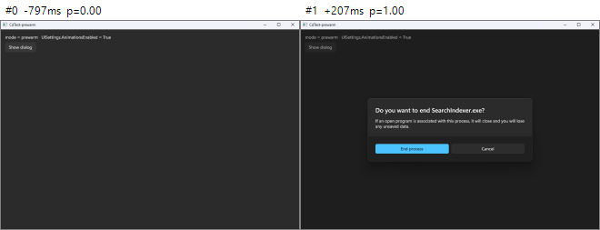
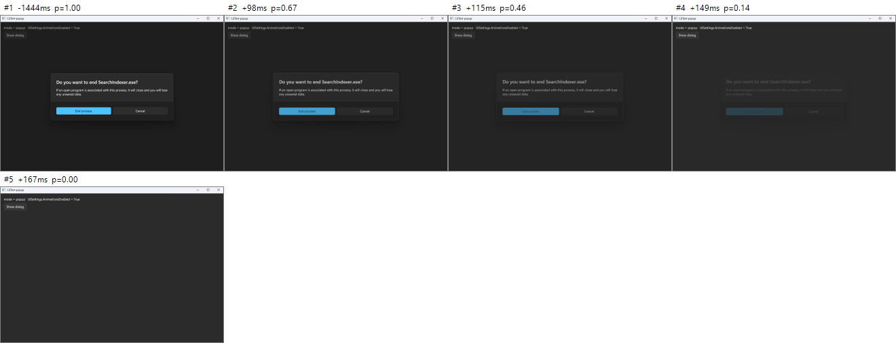
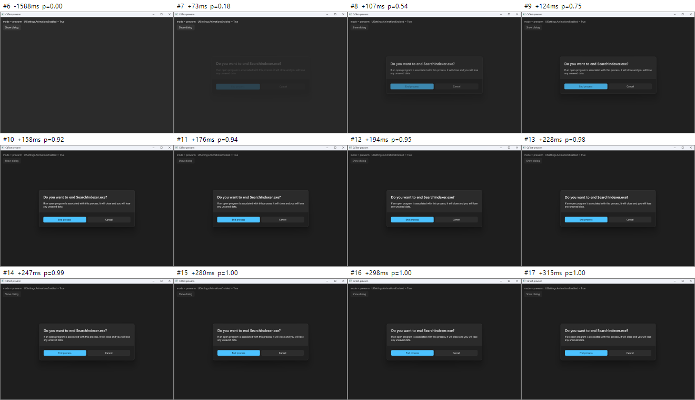
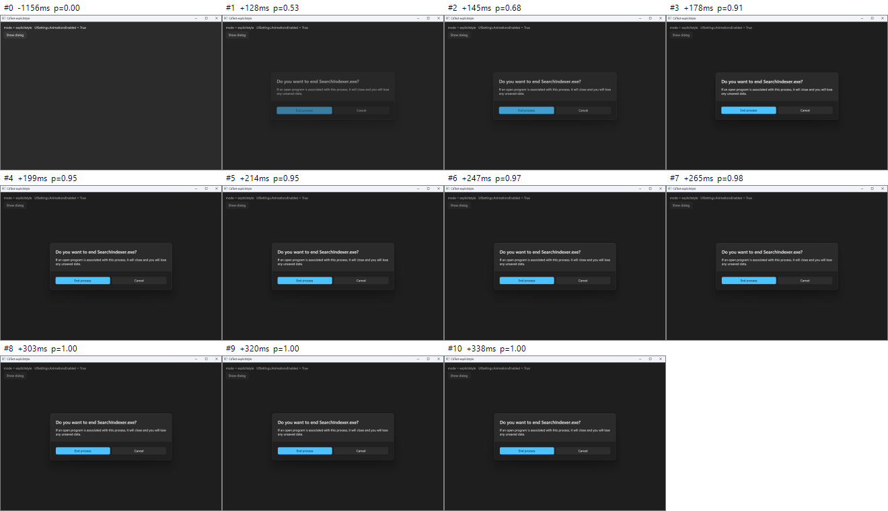
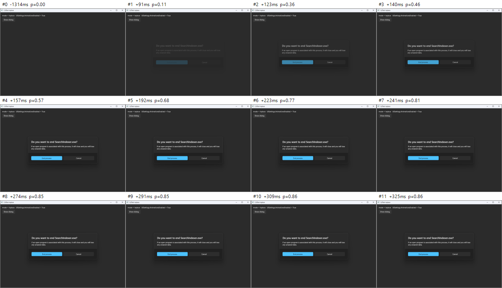
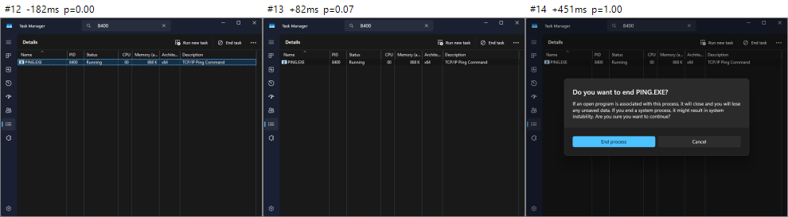
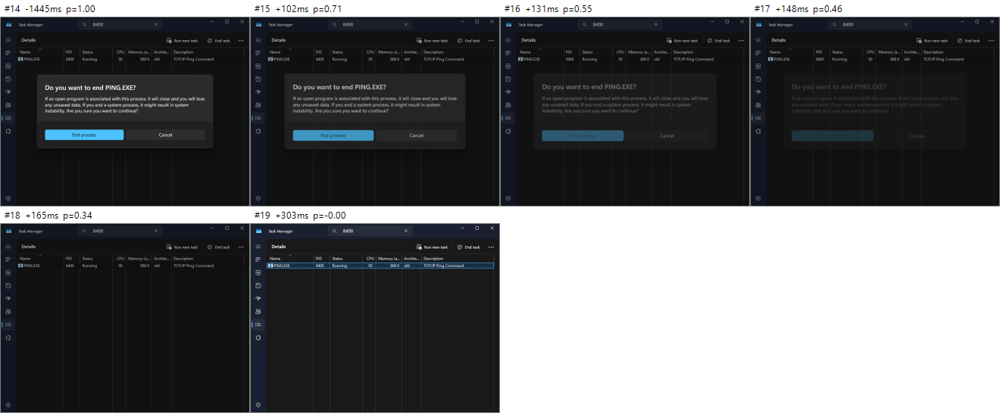

# ContentDialog 只有退場動畫、沒有進場動畫 — 原始碼分析與實測報告

對應 [microsoft/microsoft-ui-xaml#8476](https://github.com/microsoft/microsoft-ui-xaml/issues/8476) · 分析對象：本機 repo `microsoft-ui-xaml`（分支 `winui3/main`，commit `03388e3d3`）· 測試日期 2026-09-27

## 目錄

- [0. 結論摘要](#0-結論摘要)
- [1. 背景：Task Manager 用的是哪一套 XAML](#1-背景task-manager用的是哪一套-xaml)
- [2. ContentDialog 的開關動畫是怎麼實作的](#2-contentdialog-的開關動畫是怎麼實作的)
- [3. 測試方法與工具](#3-測試方法與工具)
- [4. 實測結果](#4-實測結果)
- [5. ETW 追蹤：進場 Storyboard 根本沒被建立](#5-etw-追蹤進場-storyboard-根本沒被建立)
- [6. 已排除的假說](#6-已排除的假說)
- [7. 根本原因（逐步時序＋原始碼）](#7-根本原因逐步時序原始碼)
- [8. 為什麼退場正常、第二次開啟正常](#8-為什麼退場正常第二次開啟正常)
- [9. 另一個相關缺陷：宣告在 XAML 樹中的 ContentDialog](#9-另一個相關缺陷宣告在-xaml-樹中的-contentdialog)
- [10. 套用到 Task Manager 的判斷](#10-套用到-task-manager-的判斷)
- [11. 修正建議（框架端）](#11-修正建議框架端)
- [12. App 端暫時解法（已實測有效）](#12-app-端暫時解法已實測有效)
- [13. 附錄：資料、檔案、重現方式](#13-附錄資料檔案重現方式)

## 0. 結論摘要

- **現象已重現**：WinUI 3（Windows App SDK 2.3.1 runtime）以程式碼建立的 `ContentDialog`，**第一次** `ShowAsync()` 時沒有任何進場影格（0 張中間影格，對話框一次就以最終狀態出現）；關閉時則有 2–4 張中間影格（淡出＋放大到 1.05）。
- **不是時間/效能問題**：同一個實例第二次顯示時進場動畫正常（6–7 張中間影格，約 150–250 ms）；即使在開啟那一幀故意卡住 UI 執行緒 200 ms，第二次顯示依然有動畫。
- **ETW 證據**：第一次顯示時，XAML 完全沒有 `BeginStoryboard`（進場 Layout Transition 從未被實現），卻多出 8～9 次 `CancelTransitions`；第二次顯示與所有退場都有正常的 Storyboard。
- **根本原因**：對話框在 popup 中**第一次**套用範本時，`OnApplyTemplate` 才找到 `SmokeLayerBackground` 範本元件，設定 `m_prepareSmokeLayerAndPopup = true`；接著 `BackgroundElement.SizeChanged → OnDialogSizeChanged → HostDialogWithinPopup(true)` 會**無條件**再次 `m_tpPopup->put_Child(this)`。`CPopup::SetChild` 先 `RemoveChild()`，使對話框在同一個 layout tick 內「離開再進入」可見樹：
  - `CUIElement::LeaveImpl` 呼叫 `UnregisterElementForTransitions`＋`CancelTransitions`，把剛登記、尚未實現的 **Load** 轉場丟掉；
  - 重新進入後，`m_enteredTreeCounter == m_leftTreeCounter == layoutCounter`，下一次 Arrange 被判定為 **Reparent** 觸發；而 `ContentDialogOpenCloseThemeTransition` 只參與 `Load/Unload`，所以進場動畫直接消失。
- **獨立 XAML 檔的對話框不受影響**：以 `<ContentDialog x:Class=…>` 定義、`new MyDialog()` 建立的對話框，第一次顯示就有進場動畫，根元素有沒有設 Style 都一樣（見 8.1）。只有純程式碼 `new ContentDialog()` 會觸發此缺陷。
- **App 端解法（已驗證）**：在 `ShowAsync()` 前明確指定 `dialog.Style = (Style)Application.Current.Resources["DefaultContentDialogStyle"];`，第一次顯示即恢復進場動畫（5 張中間影格，+128 → +247 ms 完成）。
- **Task Manager**：它是 XAML Islands（`DesktopWindowXamlSource`）＋系統內建 `Windows.UI.Xaml.dll`＋WinUI 2（`Microsoft.UI.Xaml.CBS`），系統 DLL 與 WinUI 2 樣式資源中都含有相同的 `SmokeLayerBackground` 機制。逐幀實測 Task Manager 的「End task」確認框：連續 3 次開啟都是一步到位（0 張進場中間影格），關閉則每次 3～5 張中間影格——與 WinUI 3 的症狀完全一致（見第 10 節）。

## 1. 背景：Task Manager 用的是哪一套 XAML

先確認 Task Manager 的對話框到底跑哪份程式碼。對 `C:\Windows\System32\Taskmgr.exe`（10.0.26100.1591）做字串分析：

| 字串 | 是否存在 | 意義 |
|---|---|---|
| `DesktopWindowXamlSource` | 有 | 以 XAML Islands 承載 XAML 內容 |
| `ContentDialog` | 有 | 使用 ContentDialog |
| `Microsoft.UI.Xaml.CBS_8wekyb3d8bbwe`、`Microsoft.UI.Xaml.Controls.XamlControlsResources`、`NavigationView`… | 有 | WinUI **2**（系統內建 CBS 套件，本機版本 9.2311.10002.0） |
| `WindowsAppRuntime` / `Microsoft.WindowsAppRuntime` | 無 | **不是** WinUI 3 / Windows App SDK |

所以 Task Manager 的 ContentDialog 本體是系統的 `Windows.UI.Xaml.dll`（10.0.26100.1301），樣式/範本則來自 WinUI 2 的 `XamlControlsResources`。本 repo 的 `dxaml/xcp/dxaml/lib/ContentDialog_Partial.cpp` 是同一份程式碼演進到 WinUI 3 的版本；issue #8476 描述的則是 WinUI 3 上的同一個症狀。因此本報告以 repo 原始碼＋WinUI 3 實測找根因，再回頭對照 Task Manager。

## 2. ContentDialog 的開關動畫是怎麼實作的

ContentDialog 有三種擺放模式（`ShowAsyncWithPlacementImpl`，`ContentDialog_Partial.cpp:677–697`）：

| 內部模式 | 何時使用 | Popup 的 Child | 動畫來源 |
|---|---|---|---|
| `EntireControlInPopup` | 對話框不在可見樹（最常見：`new ContentDialog{ XamlRoot = … }`） | ContentDialog 本身 | Popup.ChildTransitions 上的 `ContentDialogOpenCloseThemeTransition`（Layout Transition） |
| `TransplantedRootInPopup` | 對話框宣告在 XAML 樹中，用預設 `ShowAsync()` | 範本的 `LayoutRoot`（Grid） | 同上（但見第 9 節） |
| `InPlace` | `ShowAsync(ContentDialogPlacement.InPlace)` | 不用 Popup | 範本 VSM 的 `VisualTransition To="DialogShowing" / "DialogHidden"` |

重點：在 Popup 模式下，範本中寫好的 VSM 進場轉場**不會被使用**。`ChangeVisualState` 對 popup 模式固定呼叫 `GoToState(false, L"DialogShowingWithoutSmokeLayer")`（`:461`，`useTransitions=false`），而範本裡也沒有 `To="DialogShowingWithoutSmokeLayer"` 的 VisualTransition。開關動畫完全仰賴 `PreparePopup()`（`:950–996`）掛在 popup 上的轉場：

```cpp
// ContentDialog_Partial.cpp:975–984
ctl::make(&contentDialogOpenCloseTransition);
contentDialogOpenCloseTransition->SetSmokeLayer(m_tpSmokeLayer…);
transitionCollection->Append(openCloseTransition);
popup->put_ChildTransitions(transitionCollection);
```

這個轉場的行為（`LayoutTransition_partial.cpp:2330–2420`）：

- `ParticipatesInTransitionImpl`：**只在目標是 ContentDialog 且觸發為 `Load` 或 `Unload` 時**參與。
- Load（進場）：Scale 1.05 → 1.0，250 ms，cubic-bezier(0,0,0,1)；Opacity 0 → 1，83 ms；smoke 層 Opacity 0 → 1，83 ms。
- Unload（退場）：Scale 1.0 → 1.05，167 ms；Opacity 1 → 0，83 ms；smoke 同步淡出。

Load/Layout/Reparent 的判定在核心 `CTransition::OnLayoutChanged`（`dxaml/xcp/core/core/elements/LayoutTransition.cpp:770`）：

```
if (enterCounter == layoutCounter && leftCounter != layoutCounter)   → ProcessLoadTrigger（Load）
else if (enterCounter < layoutCounter ||
         (enterCounter == layoutCounter && leftCounter == layoutCounter)) → ProcessLayoutTrigger（Layout / Reparent）
```

也就是說：**同一個 layout tick 內離開又進入樹 = Reparent**，不是 Load。

## 3. 測試方法與工具

- **測試 App（CdTest）**：WinUI 3 C# 非封裝 App，Windows App SDK 2.3.1 self-contained，1000×700 視窗，對話框內容仿照 Task Manager 的「Do you want to end SearchIndexer.exe?」。以命令列參數切換情境，自動執行 `ShowAsync → 1.5 s → Hide`，並以 QPC 時間戳記錄 `ShowAsync/Opened/Hide/Closed/SizeChanged/Loaded/Unloaded` 及每幀的對話框尺寸。系統「顯示動畫」設定：`UISettings.AnimationsEnabled = True`。
- **逐幀擷取工具（Cap）**：使用 `Windows.Graphics.Capture` 擷取目標視窗；DWM 每合成一張新影格就交付一次，因此能看到動畫的每一幀。影格時間 `SystemRelativeTime` 與 App 的 QPC 同源，可精確對齊「呼叫 ShowAsync 後幾 ms 畫面出現」。
- **量化指標**：`progress = 1 − MAD(影格, 開啟完成影格) / MAD(開啟前影格, 開啟完成影格)`。沒有動畫時只會出現 0 → 1 一步到位；有淡入/縮放時會出現 0 < progress < 1 的「中間影格」。另外計算亮部差異的外框寬度，可看出 1.05 倍縮放（488 px → 504 px）。
- **ETW**：以 `logman` 收集 `Microsoft-Windows-XAML` provider（`{531A35AB-63CE-4BCF-AA98-F88C7A89E455}`，定義於 repo 的 `Microsoft-Windows-XAML-ETW.man`）的 `BeginStoryboardInfo(84)`、`StopStoryboardInfo(87)`、`EndStoryboardInfo(88)`、`CancelTransitions(511)`、`RealizeTransition(59/60)` 事件。

## 4. 實測結果

| 情境 | 說明 | 進場中間影格 | 進場：首次變化 → 穩定 | 退場中間影格 |
|---|---|---|---|---|
| `popup` | 新實例，第一次 ShowAsync（EntireControlInPopup） | 0 | +139 ms → +139 ms（一步到位） | 3 |
| `second` | 先用實例 A 開關一次（暖機全域資源），再開**新**實例 B | 0 | +61 ms → +61 ms | 3 |
| `pretemplate` | 新實例，1 秒前先 `ApplyTemplate()`＋`Measure()` | 0 | +123 ms → +123 ms | 2 |
| `presize` | 新實例，先把 Width/Height 設成視窗大小 | 0 | +75 ms → +75 ms | 2 |
| `heavy` | 新實例，開啟那幀卡 UI 執行緒 200 ms | 0 | +323 ms → +323 ms | 4 |
| `prewarm`（第 2 次） | 同一實例開關一次後**再開** | 6–7 | +73～85 ms → +228～237 ms | 3 |
| `heavywarm`（第 2 次） | 同一實例再開，且開啟那幀卡 200 ms | 7 | +288 ms → +444 ms | 4 |
| `stallwarm`（第 2 次） | 同一實例再開，ShowAsync 後立刻卡 150 ms | 6 | +222 ms → +385 ms | 3 |
| `inplace` | XAML 中宣告，`ShowAsync(InPlace)`（VSM 轉場） | 11 | +91 ms → +358 ms | 3 |
| `tree` | XAML 中宣告，預設 `ShowAsync()`（TransplantedRootInPopup） | 0 | +86 ms → +86 ms | 1（實質無動畫，見第 9 節） |
| `xamlfile` | 獨立 XAML 檔的 ContentDialog 子類別（`new MyDialog()`），根元素有 `Style="{StaticResource DefaultContentDialogStyle}"` | 5 | +155～163 ms → +288～300 ms（2 次） | 3 |
| `xamlfile_nostyle` | 同上，但根元素**不**設 Style | 4 | +152～170 ms → +256～265 ms（2 次） | 2～4 |
| `explicitstyle` | 新實例，ShowAsync 前設定 `Style = DefaultContentDialogStyle` | 5 | +128 ms → +247 ms | 2 |

「中間影格」= progress 介於 0.03 與 0.97 之間的影格。影格間隔約 16.7 ms（60 Hz），證明擷取是逐幀的——退場每次都拍到 2～4 張中間影格，進場卻一張都沒有。



*圖 1：新實例第一次開啟（`prewarm` 第 1 次）。開啟前 → 下一張影格就是完整的對話框，沒有任何中間狀態。*



*圖 2：同一次的關閉（`popup`）。可以看到淡出與放大（外框 488 → 498 → 504 px）的中間影格。*



*圖 3：同一個實例第二次開啟（`prewarm` 第 2 次）。progress 0.18 → 0.54 → 0.75 → 0.92 …，有完整的淡入＋從 1.05 縮回 1.0。*



*圖 4：套用 App 端解法（明確指定 Style）後，新實例的**第一次**開啟就有進場動畫。*



*圖 5：對照組 InPlace（VSM 轉場），進場正常。*

### App 端觀察到的副作用（可用來偵測此缺陷）

|  | 第一次開啟（壞） | 第二次開啟（好）／explicitstyle（好） |
|---|---|---|
| `ContentDialog.SizeChanged` | **兩次**，且兩次的 PreviousSize 都是 `0x0`（例：`0x0→540x208`、`0x0→984x661`）——第二次前尺寸被重設，代表元素曾離開樹 | 一次（或連續的 `0x0→540x208→984x661`） |
| `ContentDialog.Unloaded` | 在 `Opened` 同時**多觸發一次**（對話框其實還開著） | 只在真正關閉時觸發 |

## 5. ETW 追蹤：進場 Storyboard 根本沒被建立

每個 ContentDialog 開/關的 Layout Transition Storyboard 有 5 條子時間軸（對話框 TransitionTarget 的 ScaleX、ScaleY、Opacity，以及 smoke 層 Opacity），ETW 上會看到 5 筆 `BeginStoryboard`。

| 情境 / 事件時段 | CancelTransitions | BeginStoryboard | 結果 |
|---|---|---|---|
| `prewarm` 第 1 次開啟 | 10～12 | 0 | 進場轉場從未實現（兩次獨立執行皆同） |
| `prewarm` 第 1 次關閉 | 2（開始前） | 5 | 退場正常 |
| `prewarm` 第 2 次開啟 | 3 | 5 | 進場正常（Storyboard 約 283～295 ms 後 End） |
| `popup` / `pretemplate` 第 1 次開啟 | 12 | 0 | 進場轉場從未實現 |
| `presize` 第 1 次開啟 | 11 | 0 | 進場轉場從未實現 |
| `explicitstyle` 第 1 次開啟 | 4 | 5 | 進場正常（約 303 ms 後 End） |

第一次開啟多出來的 `CancelTransitions`，正是下一節描述的「離開再進入樹」所造成（`LeaveImpl`、`Popup::Open/Close` 都會呼叫它）。

## 6. 已排除的假說

1. **「第一幀太慢，動畫在畫面出現前就播完了」**——排除。`heavywarm`／`stallwarm` 故意卡住 UI 執行緒 150–200 ms，第二次開啟依然有 6–7 張中間影格；WinUI 3 的 Storyboard 會轉成 Composition 動畫，在 commit 時才開始跑，不會被 UI 卡頓吃掉。`second` 情境（新實例但全域資源已暖機、開啟很快，+61 ms 出現）仍然沒動畫。
2. **「首次顯示時 Width/Height 還沒設定，二次排版造成 >5 px 的 Layout 觸發取消了 Load」**——排除。程式碼中確實有這個現象（首次 `PrepareContent()` 時 `m_tpPopup` 仍為 null，`SizeAndPositionContentInPopup()` 直接 return），但 `presize`（事先設好尺寸）仍然 0 中間影格、0 `BeginStoryboard`。
3. **「全域資源／範本第一次載入」**——排除。`second` 情境（另一個實例已開過）與 `pretemplate` 都失敗；問題是「每個實例的第一次顯示」。
4. **「系統關閉了動畫」**——排除。`UISettings.AnimationsEnabled = True`，且退場、InPlace、第二次開啟都正常。

## 7. 根本原因（逐步時序＋原始碼）

以 `new ContentDialog { XamlRoot = … }` 後第一次呼叫 `ShowAsync()` 為例（行號皆指本 repo 的 `dxaml/xcp/dxaml/lib/ContentDialog_Partial.cpp`，除非另註）：

1. **ShowAsync（UI 執行緒，對話框不在樹上）**：模式決定為 `EntireControlInPopup`；`ApplyTemplate()`（`:787`）。此時元素不在可見樹，拿到的是框架內建預設樣式；App 的隱含樣式（`XamlControlsResources` 的 `DefaultContentDialogStyle`）要等進入樹後才會解析。
2. `HostDialogWithinPopup(false)`（`:789`）→ `PrepareSmokeLayer()`（`:998`）：因為 `m_tpSmokeLayer` 還是 null，**用程式碼建立一個 Rectangle** 當 smoke 層；`PreparePopup()` 建立 popup、掛上 `ContentDialogOpenCloseThemeTransition`（smoke 指向這個程式碼 Rectangle）；`popup.Child = this`（`:944`）。
3. **下一個 dispatcher tick**：`DeferredOpenPopup()`（`:1100`）開啟 smoke popup 與對話框 popup。`CPopup::Open` 設定 `m_enteredTreeCounter = EnteredInThisTick`（`Popup.cpp:492`）。
4. **下一幀的 layout**：對話框進入 popup root 後隱含樣式生效，**範本被重新套用**，`OnApplyTemplate` 這次找到了 `SmokeLayerBackground` 範本元件（`:276–311`）：

    ```cpp
    // ContentDialog_Partial.cpp:299–309
    if (m_placementMode == TransplantedRootInPopup || m_placementMode == EntireControlInPopup)
    {
        // … HostDialogWithinPopup will be called in the imminent OnDialogSizeChanged call
        m_prepareSmokeLayerAndPopup = m_tpSmokeLayer != nullptr;   // ← 第 1 步已建立程式碼 Rectangle，所以為 true
        SetPtrValueWithQIOrNull(m_tpSmokeLayer, smokeLayerPartAsFE.Get());
        m_isSmokeLayerATemplatePart = true;
    }
    ```

5. 對話框第一次 Arrange：`OnLayoutChanging` 把 entered counter 換成目前的 layoutCounter N；`OnLayoutChanged` 判定為 **Load**（`LayoutTransition.cpp:770–772`），`ProcessLoadTrigger` 把 `ContentDialogOpenCloseThemeTransition` 登記到 LayoutManager 的「延遲轉場」清單——此時尚未建立 Storyboard，要等本幀稍後 `RealizeRegisteredLayoutTransitions()` 才實現（`xcpcore.cpp` 的 frame 流程）。
6. 同一個 `UpdateLayout` 中 `BackgroundElement` 從 0×0 得到尺寸 → `SizeChanged` → `OnDialogSizeChanged`（`:1879–1899`）：

    ```cpp
    if (m_prepareSmokeLayerAndPopup)
    {
        m_prepareSmokeLayerAndPopup = false;
        IFC_RETURN(HostDialogWithinPopup(true /*wasSmokeLayerFoundAsTemplatePart*/));   // :1887
    }
    ```

7. `HostDialogWithinPopup(true)` 更新 smoke popup、以新 smoke 重建 ChildTransitions（`PreparePopup(true)`），然後**無條件**執行：

    ```cpp
    // ContentDialog_Partial.cpp:944
    IFC_RETURN(m_tpPopup->put_Child(m_placementMode == PlacementMode::EntireControlInPopup ? this : …));
    ```

    即使 popup 的 Child 本來就是 `this`。
8. `CPopup::SetChild`（`Popup.cpp:2606`）一開頭就 `RemoveChild()`（`:2615`），對話框**在已開啟的 popup 中離開可見樹再重新加入**：
    - 離開：`CUIElement::LeaveImpl`（`uielement.cpp:1832–1833`）`pStorage->UnregisterElementForTransitions(this)`——「kills unrealized transitions in the layout manager」——第 5 步登記的 Load 轉場被清掉；接著 `CancelTransitions(this)`；並設定 `m_leftTreeCounter = GetLayoutCounter()`（`uielement.cpp:1879`），註解明寫「if an enter occurs in the same tick it will be counted as a reparent」。
    - 重新進入：`m_enteredTreeCounter = EnteredInThisTick`。
9. 同一 tick 的再次 Arrange：entered = left = layoutCounter → 走 `ProcessLayoutTrigger`，觸發類型為 **Reparent**。`ContentDialogOpenCloseThemeTransition::ParticipatesInTransitionImpl` 只接受 Load/Unload（`LayoutTransition_partial.cpp:2336–2337`），沒有任何轉場被登記。
10. 本幀 `RealizeRegisteredLayoutTransitions()` 時清單中已沒有對話框 → 不建立 Storyboard（ETW：0 次 `BeginStoryboard`）→ 對話框與 smoke 層直接以最終狀態被合成，畫面「啪」一下出現。App 端看到的「第二次 SizeChanged（PreviousSize 0x0）」與「開著卻收到 Unloaded」就是這次離開/重入留下的痕跡。

## 8. 為什麼退場正常、第二次開啟正常

- **退場**：關閉時對話框已完整佈局，`m_prepareSmokeLayerAndPopup` 早已被消耗為 false，不會有任何 re-host；`Popup::Close` → `UIElementCollection` 的移除流程走 `ProcessUnloadTrigger`，`Unload` 觸發，轉場正常播放。
- **同一實例第二次開啟**：範本已是最終範本、`m_tpSmokeLayer` 已是範本元件、`m_prepareSmokeLayerAndPopup == false`，`BackgroundElement` 尺寸也沒變（不觸發 `OnDialogSizeChanged`），因此不會 re-host，Load 轉場順利實現。
- **明確指定 Style 的解法為何有效**：Style 在 `ShowAsync()` 前就是最終樣式，`ShowAsync` 內的 `ApplyTemplate()`（此時模式已是 `EntireControlInPopup`）就會套上最終範本；`OnApplyTemplate` 執行時 `m_tpSmokeLayer` 仍為 null → `m_prepareSmokeLayerAndPopup = false`，且之後進入樹時範本不會再被重新套用，自然不會 re-host。
- 這也解釋了為什麼有些 App 的 ContentDialog 看起來「有動畫」：Microsoft Learn 的 ContentDialog 範例程式碼本來就有 `dialog.Style = Application.Current.Resources["DefaultContentDialogStyle"] as Style;` 這一行。

### 8.1 「獨立 XAML 檔的對話框有動畫、後端程式碼建立的沒有」

實測確認這個現象（上表 `xamlfile`／`xamlfile_nostyle`）：以獨立 XAML 檔定義的 `ContentDialog` 子類別（`<ContentDialog x:Class="…">`，在程式中 `new MyDialog()` 後 `ShowAsync()`），第一次顯示就有 4～5 張進場中間影格；而且**即使根元素沒有設定 Style** 也一樣有動畫。

App 端事件同時顯示：這類對話框的 `SizeChanged` 是連續的（`0x0→540x208→984x661`），開啟期間也**沒有**多餘的 `Unloaded`。也就是說，第 7 節「進入 popup 後範本被重新套用 → re-host → Load 轉場被取消」這條路徑沒有發生。

合理的解釋（依行為推論，未在閉源的解析器中逐行確認）：透過 XAML 解析器（`InitializeComponent`）建立的元素，在建立當下就解析到 App 的隱含樣式；因此 `ShowAsync()` 內套用的已經是最終範本，進入 popup 後不會再換範本。純程式碼 `new ContentDialog()` 則要等進入可見樹才換成隱含樣式，因此觸發缺陷。第 12 節「在 ShowAsync 前明確指定 Style」的解法，本質上就是讓程式碼建立的對話框也有同樣的條件。

注意：這和第 9 節的「宣告在頁面 XAML 樹中」是兩回事。對話框直接放在頁面元素樹裡、以預設 `ShowAsync()` 顯示時（`tree`），進場與退場都沒有主題轉場。

## 9. 另一個相關缺陷：宣告在 XAML 樹中的 ContentDialog

在 XAML 中宣告、以預設 `ShowAsync()` 顯示的對話框走 `TransplantedRootInPopup`：popup 的 Child 是範本中的 `LayoutRoot`（Grid）。實測中 `DumpPopups()` 也確認 `child=Grid`。但 `ContentDialogOpenCloseThemeTransition::ParticipatesInTransitionImpl` 要求目標必須是 `IContentDialog`，Grid 不符合，因此這個模式**進場與退場都不會有主題轉場**（實測進場 0 張、退場只有 1 張過渡影格，屬 popup/smoke 分兩幀移除的殘影，不是動畫）。這與本報告主因無關，但修正時應一併處理（例如判斷目標是否為某個 ContentDialog 的 `LayoutRoot` 範本元件）。

## 10. 套用到 Task Manager 的判斷

**靜態證據（已確認）**

- `Taskmgr.exe` 使用 `DesktopWindowXamlSource` ＋ WinUI 2 CBS（`XamlControlsResources`）＋ `ContentDialog`，不含 Windows App SDK。
- 系統 `Windows.UI.Xaml.dll`（10.0.26100.1301）含有字串 `SmokeLayerBackground`、`DialogShowingWithoutSmokeLayer`、`SystemControlPageBackgroundMediumAltMediumBrush`——正是本 repo 中 smoke 範本元件／re-host 邏輯與程式碼建立 smoke 時使用的資源名稱。
- WinUI 2 CBS 套件的 `resources.pri`（內含 ContentDialog 範本）含有 `SmokeLayerBackground`。
- Task Manager 的對話框由程式碼建立並以隱含樣式（來自 `XamlControlsResources`）取得範本——與本報告的觸發條件（新實例、範本在進入 popup 後才改套隱含樣式、範本含 SmokeLayerBackground）相符。

**動態實測（已確認）** 以 UI Automation 驅動 Task Manager Details 頁的「End task」確認框：目標是我自行啟動的 `PING.EXE`（先在搜尋框輸入其 PID 讓清單只剩這一列），每次只按「Cancel」，連續 3 次，同時逐幀擷取 Task Manager 視窗。PING 全程存活，未結束任何其他處理程序。

| 次數 | 進場 | 退場 |
|---|---|---|
| 第 1 次 | 一步到位：+451 ms 直接出現完整對話框（外框 488 px） | 4 張中間影格：488 → 500 → 504 px 放大＋淡出，+303 ms 完成 |
| 第 2 次 | 一步到位：+408 ms | 5 張中間影格，+283 ms 完成 |
| 第 3 次 | 一步到位：+430 ms | 3 張中間影格，+278 ms 完成 |

（每次進場前那張 progress≈0.07 的影格是清單選取列失去焦點時的反白變化，不是對話框。）症狀與 WinUI 3 實測完全相同；且第 2、3 次也沒有進場動畫，表示 Task Manager 每次都建立新的 ContentDialog 實例——正是「每個新實例的第一次顯示必定失敗」的情況。



*圖 6：Task Manager「Do you want to end PING.EXE?」進場：前一張沒有對話框，下一張就是完整對話框。*



*圖 7：同一個對話框按 Cancel 的退場：有連續的淡出＋放大影格。*

**推論** 系統 XAML 是閉源二進位，無法逐行比對；但元件名稱（`SmokeLayerBackground` 等）、流程與逐幀症狀完全一致，Task Manager 命中的應是同一個缺陷。附註：Task Manager 的「Run new task」開啟的是傳統 Win32「建立新工作」視窗，並非 ContentDialog。

## 11. 修正建議（框架端）

> 以下修改未在本機編譯驗證（完整建置 WinUI 需要大型工具鏈與套件來源，本次未進行）；根因本身已由第 4、5 節的實測確認。

### A. 不要無條件重設 Popup.Child（主要修正）

```cpp
// ContentDialog::HostDialogWithinPopup，取代 :944
ctl::ComPtr<xaml::IUIElement> desiredChild =
    m_placementMode == PlacementMode::EntireControlInPopup
        ? ctl::ComPtr<xaml::IUIElement>(this)
        : m_tpLayoutRootPart.AsOrNull<xaml::IUIElement>();
ctl::ComPtr<xaml::IUIElement> currentChild;
IFC_RETURN(m_tpPopup->get_Child(&currentChild));
if (!ctl::are_equal(currentChild.Get(), desiredChild.Get()))
{
    IFC_RETURN(m_tpPopup->put_Child(desiredChild.Get()));
}
```

避免已開啟的 popup 中子元素離開/重入，Load 轉場即可保留。（也可以考慮在 `CPopup::SetChild` 對「設成同一個 child」直接 no-op，但影響面較大，需評估 `ClearUCRemoveLogicalParentFlag` 那段特例。）

### B. 重用既有轉場物件，只更新 smoke 目標

`PreparePopup(true)` 目前會建立新的 `TransitionCollection` 與新的 `ContentDialogOpenCloseThemeTransition`。但 LayoutManager 裡已登記的是舊轉場物件（`m_registeredTransitions` 持有強參考），其 smoke 弱參考指向已被換掉的程式碼 Rectangle。只做 A 的話，對話框會有動畫，但 smoke 會少了淡入。建議改成：若 popup 已有 `ContentDialogOpenCloseThemeTransition`，就呼叫其 `SetSmokeLayer(新 smoke)` 而不是替換整個集合——`CreateStoryboardImpl` 是在實現時才讀取 smoke 層，因此同一幀內更新即可生效。

### C. 從源頭避免「晚一步」才發現範本元件

讓第一次 `ShowAsync` 就能解析到最終樣式（或把對話框掛到 popup、解析隱含樣式後再決定 smoke 層），使 `m_prepareSmokeLayerAndPopup` 這條補救路徑不再需要。

### D. 補上 TransplantedRootInPopup 的轉場（第 9 節）

讓 `ParticipatesInTransitionImpl` 也接受「ContentDialog 的 LayoutRoot 範本元件」，或在該模式把轉場改掛在正確的目標上。

### 建議的回歸測試

- 新實例第一次 `ShowAsync()` 後，驗證有 Load 轉場被實現（例如內部 hook 檢查 `LayoutTransitionStorage` 有 Storyboard，或以 ETW `BeginStoryboardInfo` 斷言）。
- 驗證開啟期間 `ContentDialog.Unloaded` 不會被觸發、`SizeChanged` 的 PreviousSize 不會被重設為 0×0。

## 12. App 端暫時解法（已實測有效）

```csharp
// C#
var dialog = new ContentDialog
{
    XamlRoot = this.Content.XamlRoot,
    Style = (Style)Application.Current.Resources["DefaultContentDialogStyle"],   // ← 關鍵
    Title = "...",
    PrimaryButtonText = "...",
    CloseButtonText = "Cancel",
};
await dialog.ShowAsync();
```

```cpp
// C++/WinRT
dialog.Style(Application::Current().Resources()
    .Lookup(box_value(L"DefaultContentDialogStyle")).as<Style>());
```

- 實測：第一次開啟即有 5 張中間影格、+247 ms 完成；ETW 有 5 筆 BeginStoryboard；不再出現多餘的 Unloaded。
- 若 App 使用自訂的 ContentDialog 樣式，改成指定該樣式即可——重點是「在 ShowAsync 之前就讓 Style 是最終值」。
- 替代（不建議）：重複使用同一個 ContentDialog 實例（只有第一次沒動畫），或先隱形開關一次暖機。
- Task Manager 這類系統 App 使用者無法套用，需要 Microsoft 在系統 XAML／WinUI 修正。

## 13. 附錄：資料、檔案、重現方式

### 測試環境

- Windows 11 IoT Enterprise LTSC 2024，10.0.26100；`Windows.UI.Xaml.dll` 10.0.26100.1301；`Taskmgr.exe` 10.0.26100.1591；WinUI 2 CBS 9.2311.10002.0。
- WinUI 3：Microsoft.WindowsAppSDK 2.3.1（self-contained）、.NET 8、x64；顯示器 60 Hz。
- Repo：`C:\Users\User\Documents\microsoft-ui-xaml`，`winui3/main` @ `03388e3d3`。

### evidence 資料夾內容

- `evidence/img/`：各情境逐幀膠卷圖（檔名即情境）。
- `evidence/runs/<情境>/`：`summary.txt`（逐幀 progress／外框）、`frames.csv`、`applog.csv`（App 事件與每幀狀態，最後一欄為 QPC ms）。
- `evidence/etw/<情境>.txt`：ETW 解析結果（Storyboard／CancelTransitions 事件時間軸）。
- `evidence/tools/`：測試 App（CdTest）、逐幀擷取工具（Cap）、ETW 腳本與 Task Manager UIA 腳本的原始碼。

### 重現

```powershell
# 1) 建置
dotnet build -c Release tools\CdTest\CdTest.csproj
dotnet build -c Release tools\Cap\Cap.csproj
# 2) 逐幀擷取（mode: popup / prewarm / second / pretemplate / presize / heavy / heavywarm / stallwarm / inplace / tree / explicitstyle）
Cap.exe --launch CdTest.exe --args "popup --auto out\applog.csv" --title CdTest-popup --out out --duration 15000 --applog out\applog.csv
# 3) ETW（需系統管理員）
etwrun.ps1 popup popup ; etwparse.ps1 runs\etw_popup
# 4) Task Manager（需系統管理員；只會開啟 End task 確認框並按 Cancel，目標是自行啟動的 ping）
$ping = Start-Process ping.exe -ArgumentList "-n 100000 127.0.0.1" -WindowStyle Hidden -PassThru
tm_endtask.ps1 -times 3 -log out\applog.csv -targetPid $ping.Id
```
